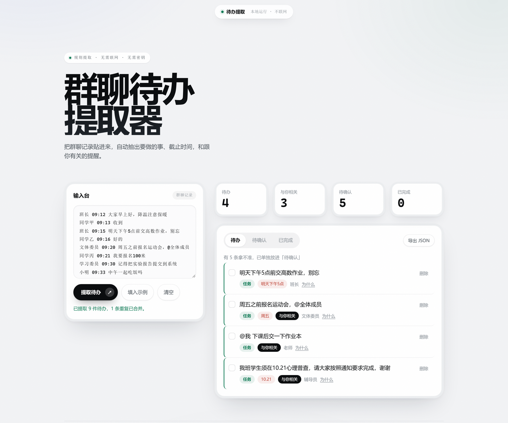

# 话里有事

**群聊待办提取器** —— 把一段群聊记录贴进去，自动抽出里面"要做的事"、截止时间，以及"跟你有关"的提醒，还能在日历里看时间分布。纯前端、本地运行；默认不联网、只用本地规则，也可以自己配置可选的 AI 服务来整理。

## 怎么用

1. 下载本项目，双击 `index.html` 用浏览器打开即可，无需安装、无需联网。
2. 把群聊记录贴进文本框（每行一条，格式：`昵称 时间 内容`），或点「填入示例」看演示。行首的「注：」「截止时间：」「地点：」这类**标签**不会被当成昵称；一行里如果写了不止一件事（句号断开，或「，并且…」「，然后…」另起一件），会拆成几条**分别**判断——拆出来的每一段都得自己站得住才留下。
3. 点「提取待办」，结果按 **待办 / 待确认 / 已完成** 三个标签分组，显示在左侧。
4. 点任意一条，右侧「输入台」会切换成这条的**解析**——列出提取依据，并在原文里高亮关键片段；点「返回输入台」或再点一次该条即切回。列表里每条**最多显示两行**（超出打省略号）——待办台是拿来扫的，不是拿来读的，全文在解析面板里一个字都不少。列表和解析标题显示的都是**主干**：剥掉行首的「注：」标签、剥掉括号，只留能一眼扫完的那句（"每人3次成绩，按最高分、次高分、第三次高分成绩填入表格"）；括号里的内容不会丢——「如果…就…」会成对拎进解析的「条件」块，其余的在「原文」里一字不动。解析面板底部还有一个「**打开原文**」，点开会把这条待办放回**你粘贴的那一整行**里，并把抽出来的那一段标出来：一行被切成两条时，你能看见"这句话里还有另一半"。每条也能勾选完成、点「删除」移除（删除前先弹确认，确认后条目沿弧线滑出）。旁边的「全部完成」可一次性结清当前标签下的所有待办。
5. 按住每条最左边的点阵把手可以拖动：上下拖是**排序**，拖到列表外、放进左下角的**垃圾桶**就是删除。拖动时条目会浮在所有东西上面（包括右侧的输入台）；删除后底部出现一条限时 6 秒的「撤销」，**连删几条会累加**（「已删除 3 条」），点一次全部还原。把手聚焦后回车拾起、↑/↓ 移动、回车放下、Esc 取消，键盘也能排序。
6. 点右上角「多选」进入多选模式：点整行即选中，Shift 点击可连选，顶部批量条会出现「已选 N 条」和全选 / 标记完成 / 删除 / 取消；在「已完成」标签下不显示「标记完成」——那里没有可完成的事。
7. 点右上角「▦ 日历」切到**日历视图**：列表看「做什么」，日历看「什么时候」。有截止日期的条目落在对应日期上，过期未完成标红；可切换月份、回到今天、显示或隐藏已完成。原文里没识别出日期的条目收在「未排期」，点开任意一条，在右侧「日历排期」里手动选日期或清除。日历顶部还有「＋ 添加待办」：直接写一条要干的事、选个日期（留空就进「未排期」），它只存本机，不改群聊原文。
8. 顶栏的「牛皮纸 / 纸白」按钮切换**主题**：点击后从按钮位置圆形展开换色，选择记在本浏览器，刷新后保持。
9. 右上角「⚙ AI」打开**可选 AI 设置**：填服务商、接口地址、模型与 API Key 后，点「提取待办」会把整段群聊交给该服务直接整理成待办。不配置时一切照旧走本地规则；AI 请求失败也会自动退回本地规则。

## 做了什么

- **规则提取**：按动作词、截止时间、`@你`、面向全班等信号抽取待办。群里约的活动（打球 / 打羽毛球 / 跑步 / 游泳 / 健身 / 爬山 / 看电影等）带明确时间也算待办——"周六周天要打球"不会因为没写"记得"就掉进「待确认」。默认提取全部是本地正则/关键词规则，不需要 API、不需要密钥。
- **先筛噪声**：疑问句（"中午一起吃饭吗""这道题怎么做"）不当成交代；否定、已完成和取消通知（"笔记已经交了""不用交作业了""今晚的选修课取消了""周六考试取消了"）不产生新待办——取消通知里恰好有动作词也不会被反判成待办；但"记得取消场地""帮我取消预约"这种让人去取消的话仍然保留。单字动词只在不是别的词的一部分时才算（"交流""带来""须知"里的"交""带""须"不算），含糊词同理（"想出来的选题"里的"想"不算犹豫）。「记得 / 请 / 麻烦 / 别忘了」这类祈使语气可以把"有动作、没日期"的句子推进待办。
- **长通知拆条**：逗号后如果开始了一件**带时间、带动作**的新事，会拆成单独一条——"……提交完就行了，**下周**要汇报的小组找我**报名**"会得到两条；"今天先这样，明天再说"因为后面没有动作词，不会被拆碎。每一段仍要各自过提取门槛，过不了的直接丢弃，不造半截待办。
- **时间识别**：除了"明天下午5点前""10.21""周五之前""三天后"，还认时段 + 钟点（"晚上7点""下午两点半"，落在今天）、"月底 / 月初"、"这周内"（落到周日）、"大后天""礼拜一""下下周"；"19号晚上9点前"会整段保留为截止说法（日历仍按天落到 19 日）；"3号线""3号楼""1.5倍"不会被当成日期。相对事件（"放学前""下课后"）保留原文说法，但日历里进「未排期」，不猜具体日期。
- **可解释**：点开任意一条，右侧解析面板会摊开它命中了哪个关键词 / 时间 / 选一约束（如「三选一」）/ 与你相关的理由，原文里高亮出对应片段。依据一律**引用实际命中的那几个字**（如「面向全班『@所有人』」），不写死标签——写死的标签一旦和原文不符，整块依据就不可信了。动作词取**信息量最大**的那个（先比长度，再比谁出现得早），所以"尽快完成考试，并且在提交之后…"报的是「完成」而不是被"提交"抢走。
- **打开原文**：每条记着自己是从**粘贴内容的第几行**抠出来的。解析面板底部的「打开原文 · 第 N 行」展开后，显示那一行的完整原文，并把这条对应的片段标黄。正文和整行一字不差时（纯一行、没前缀、没被切）不留这个按钮——那会是个点开等于什么都没给的开关。
- **待确认**：措辞含糊（"可能""到时候"）或只命中时间、没有明确动作的条目单独归入「待确认」，交给人判断，而不是假装确定。点开详情可以点「确认为待办」一键转正，依据里会留下"由你手动确认为待办"，刷新后保持。
- **去重与追加**：同一句话重复出现自动合并，并提示合并了几条。再次点「提取待办」是往现有清单里**追加**，不是替换上一批：清单里已有的同一句话直接跳过，原有条目的完成状态、手动排期和顺序都不动；不过如果原来那条在「待确认」、这次规则 / AI 已明确判成待办，会顺手把它转正（已完成的不动）——否则旧的误判重新提取多少遍都卡在原处。空输入或这次没识别到新待办时，清单原样保留，只给一句提示。每条待办记着自己的导入时间，「导入于」显示的是它进来的那天，而不是最近一次提取的时间。
- **类型标签**：每条标为 **任务 / 提醒 / 请求 / 说明** 四类之一，一眼区分"要去做""知道一下""有人求你""这是规则不是活儿"。「说明」是补充规则（"每人 3 次成绩，按最高、次高、第三次填进表格"）——它不是让你去做的事，所以用的是纸底虚线标签，和三种实心撞色分开；它照常进「待确认」，等着人来判断，而不是被悄悄丢掉。判断有两条信号：行首是「注 / 说明 / 规则 / 格式 …」这类标签，或者**唯一的动作词躲在括号里的假设句中**（"（如果同学参加了三次考试…）"里的"参加"不算交代你做的事）——后一种情况「提取依据」会直接把这句话写出来。
- **条件**：括号里的「如果…就…」是规则骨架，不是可以一截了之的括号废话。解析里单列成「条件」块，一条规则一行（"如果同学参加了三次考试 → 填报 3 次"）。括号规则是：按逗号/分号切，以「就」开头的段并到前一段上，**至少凑出两对**才算数；凑不出来就说明它不是这个形状，整段当补充说明，不硬拆。括号外单独成句的「如果…就…」（"如果前面的小组标题和你的一致，就得重新准备"）也会收进同一个条件块。
- **依据说人话**：说明类的依据先自报家门（"说明性文字「注」"），再给正面信息（"识别到 3 条「如果…就…」条件"），而不是绕一圈只说"它为什么不算任务"。另外「如果…就…」是**确定的条件**，不是"可能 / 到时候"那种犹豫——判措辞含糊时会跳过它（真含糊的"如果有空"仍会被"有空"抓住）。
- **本地存储**：数据只存在本浏览器（localStorage），刷新不丢；不配置 AI 时不上传、不联网。
- **可选 AI 提取**：在「⚙ AI」里自行填写服务商（DeepSeek / OpenAI / 本地 Ollama / 自定义 OpenAI 兼容接口）、接口地址、模型与 Key。配置后整段群聊直接交给 AI 整理，一次最多发送前 12000 字；没配置、缺 Key 或请求失败时自动回退本地规则。AI 返回的每条都必须带**逐字出现在原文里的证据**，对不上的整条丢弃；相同输入会命中本地缓存，避免重复请求。Key 只存 localStorage，不写进代码或仓库。
- **日历视图**：与列表共用同一批条目，只是换个时间视角。有截止日期的落在月历对应日期，过期未完成用红条标出；可切换月份、回到今天、显示或隐藏已完成。原文没识别出日期的进「未排期」，详情面板里可手动排期或清除——只改日历位置，不改原文的截止说法。月历格按当天条目数分三档底纹，周末另用一档颜色。
- **双主题**：纸白 / 牛皮纸两套主题，颜色全部走 CSS 语义层，牛皮纸主题只重映射语义变量；顶栏按钮一键切换，点击位置圆形展开，背景 WebGL 着色器同步换色。选择存 localStorage，首屏内联脚本提前落主题，刷新不闪白。
- **界面**：新粗野主义（Neo-brutalism）风格——复古撞色（芥末黄 × 靛蓝 × 陶土 × 灰绿）、2px 硬描边、无 blur 的实心硬阴影、衬线斜体大标题 × 无衬线正文 × 等宽标签三种字体混搭，负空间刻意不对称（左宽右窄、统计块右下留空）。背景是原生 WebGL 着色器（主题四色在纸底上缓慢晕染漂移 + 细纸噪点，并随主题换色），大标题带 3D 挤出立体字。空态是一张「填入示例并提取」的引导卡，一键出结果。左侧放结果（每条待办显示自己的导入时间）、右侧放输入台（吸顶，点条目时原地切换成解析面板）。纯手写 CSS/JS（无框架、无构建），动效只用 transform/opacity，适配移动端与「减少动态效果」系统设置。

## PRD 之外的追加

AI、日历与主题已经写回 [PRD.md](PRD.md) 的「做什么」；下面五项仍是 PRD 之外的追加，单独列出来，免得文档跟实现对不上：

- **拖拽排序**：每条待办最左侧有一个点阵把手，按住可以上下拖动调整先后顺序。被拖的那条会抬起跟随指针，其余条目让开空位。也支持键盘——把手聚焦后回车拾起、↑/↓ 移动、回车放下、Esc 取消（Esc 会退回原来的顺序）。顺序同样存进 localStorage。这是对「贴群聊→提取待办」之外的**功能扩展**，不是原 PRD 的一部分。
- **批量完成**：列表区右上角「全部完成」，把当前标签下所有未完成的条目标为完成。多条会依次进入完成态（条数多时自动压缩间隔，整段封顶约 0.6 秒），再依次退场。单条勾选**不加**任何动效——那是高频操作。
- **拖进垃圾桶删除**：拖动时条目两轴跟随指针，可以拖出列表盒子，并且**浮在整页最上层**（一路拖到右侧输入台上面也不会被它盖住）；待办区左下角有一个垃圾桶，松手落在桶上即删除，条目会缩小着飞进桶里。垃圾桶有三档状态：静息是**软灰实心描边 + 小硬阴影**（安静但是个真实物件，标签始终读得清），拖拽一开始转成黑描边黑阴影（醒来），瞄准时变红放大歪 3°（张开口）。**这条删除路径不弹二次确认**（拖动本身就是明确意图），改用底部一条 6 秒的「撤销」兜底，**并且按批次累加**——连着拖掉三条就是「已删除 3 条」，一次撤销全部按原位置还回来（批次倒序还原，批次内按原索引升序插回，索引才不会互相顶位）。而「删除」按钮走的仍是二次确认弹窗——确认过的删除就是终局，不给撤销，两者语义分开。
- **多选模式**：右上角「多选」是个开关。开启后每行的框从「完成」换成「选中」、整行点击的含义跟着变、行内不再显示「解析」，顶部出现批量条（已选 N 条 / 全选 / 标记完成 / 删除 / 取消）；「已完成」标签下「标记完成」会隐藏。勾选框刻意做成实心方块而不是对勾，跟「完成」的勾区分开。Shift 点击连选；切换标签或重新提取会清空选中。
- **日历手动添加**：日历顶部「＋ 添加待办」可以自己写一条要干的事，默认落在当前选中的日期，也可以清空日期放进「未排期」。它属于本机数据，和提取结果一起存 localStorage，点开同样有「解析」和删除、完成；依据一栏只写「手动添加」，不伪造提取理由。

## 暂不做什么

不自动连接微信/QQ，不做登录，不做后端、数据库、云端同步，不做日历导出/日历同步。默认不联网，也不内置任何 AI 密钥或代理；AI 是可选增强，只有用户自己配置后群聊内容才会发往其填写的第三方服务。范围以 [PRD.md](PRD.md) 为准。

## 已知问题 / 边界

- 提取靠关键词规则，口语化、没关键词的待办可能漏掉；这是第一版的取舍，不是没做完的接口。
- 活动词是**白名单**（打球 / 打羽毛球 / 跑步 / 游泳 / 健身 / 爬山等常见项目），没收录的活动名不会被当成"动作"；只给时间、既没动作词也没收录活动名的句子，仍会进「待确认」等人判断。
- 时间识别只覆盖常见写法（"明天下午5点前""下周二下午""10.21""周五之前""本周六周日""三天后""24小时后""两个工作日内""晚上7点""下午两点半""月底"等），复杂表达会漏。"放学前 / 下课后"这类相对事件能被认出来并保留原文，但**不会换算成具体日期**，日历里进「未排期」——宁可让人自己排，也不猜一个错的日期。
- 行内切句在 **。；！？**、**逗号 + 连接词**（并且 / 然后 / 还要 / 而且 / 另外 / 同时 / 以及 / 再），以及**逗号后开始一件带时间、带动作的新事**时切；其余逗号不切，为的是不把"三选一"那种一整句的约束切碎。用逗号并列、但后面没带时间的两件事（"交完作业，把报告也带上"）仍是同一条。
- "与你相关"只能靠 `@我`、面向全班等显式信号判断，无法理解真正的语义相关性。
- 「打开原文」的行号是**你粘贴的那份文本里的行号**（空行也算一行），不是"提取出来的第几条"。它靠条目里存的原始行工作，所以**只有本次改版之后重新导入的条目才有这个按钮**；浏览器里若还留着更早的旧数据，那批条目不会出现它——再点一次「提取待办」就有了。
- 主干文本是**删**出来的（删标签、删括号），不是改写出来的——所以括号里那部分信息不会出现在列表和标题里。如果括号里恰好就是要做的事（"交作业（第3章习题）"），列表会只显示"交作业"，「第3章习题」在解析的「原文」里还在。宁可让扫读时短一点，也不替原文编句子。
- 拖拽排序只在**当前标签可见的那些条目之间**调整先后，其他标签下被隐藏的条目位置不动（否则调一次"待办"，会把"已完成"的顺序也搅乱）。
- 垃圾桶用 `position: sticky` 挂在**待办区左下角**，所以列表长短它都在：待办区没超出屏幕时它就待在盒子下沿不动；一旦盒子比视口还长（贴一段真实群聊很容易出 20+ 条），拖拽开始它会滑到**视口左下角**，全程够得到。静止时如果它本来就在折线以下，拖拽开始会看到它"滑进来"——这不是跳变，是同一个 sticky 约束在起作用。
- 多选模式的选中框是原生 `<input type="checkbox">`，所以纯键盘也能用：Tab 聚焦、空格勾选，再 Tab 到批量条执行；拖动排序另有回车拾起 / ↑↓ 移动 / 回车放下的键盘路径。**只有"拖进垃圾桶删除"这一条路是纯指针的**（拖动本身就是这个手势的语义），键盘用户走行内的「删除」按钮或多选批量删除。
- AI 提取需要自备服务与网络：请求由浏览器直连你填写的接口，可能受 CORS 限制；一次最多处理前 12000 字，超出部分不发送。AI 的证据校验只认逐字出现在原文里的片段，改写过的"依据"会导致条目被丢弃；请求失败会自动回退本地规则并在结果旁提示。
- 日历日期来自原文识别，相对日期（今天 / 明天 / 周五）以**每条自己的导入时间**为锚点：后导入的批次不会改写先前条目的日期，同一批聊天反复打开日期也不会漂移；认不出的不猜，进「未排期」等手动排期。手动排期只改日历位置，不改原文的截止说法。
- 主题选择存在本浏览器，不是账号级设置；换浏览器或用无痕模式会回到纸白主题。
- 演示与示例均为**合成数据**，不包含任何真实姓名、手机号、学号等信息。

## 文件说明

- `index.html` / `styles.css` / `app.js` —— 页面、样式、提取逻辑
- `bg-shader.js` —— WebGL 背景着色器（随主题换色）
- `PRD.md` —— 需求边界与验收标准
- `CLAUDE.md` —— 给 AI 协作者看的规则
- `sample-chat.txt` —— 合成群聊样本
- `demo.png` —— 界面演示截图

## 协同复盘

这个项目我负责定方向、出题和验收，AI 负责写代码。第一步我用 PRD 把范围钉死——只做"贴群聊→提取待办"，不接微信、不调模型，压住了 AI 越做越大的冲动。AI 生成代码后，我拿合成数据逐条测试，很快抓到两个 bug："我班学生须在…"被判成"与你无关"、"10.21"这类日期识别不到；我把反例贴回去，AI 改关键词和正则就修好了。之后又加了类型标签；再往后才把「可选 AI 提取、日历视图、双主题」写进 PRD 并实现——AI 仍然只是可选增强，默认路径必须保持离线可用。最深体会：把"为什么提取这条"做成可解释、把拿不准的放进"待确认"，比盲目追求识别率更实在；AI 改得快但必须逐条验收，没实现的功能不能被它写成已实现。
